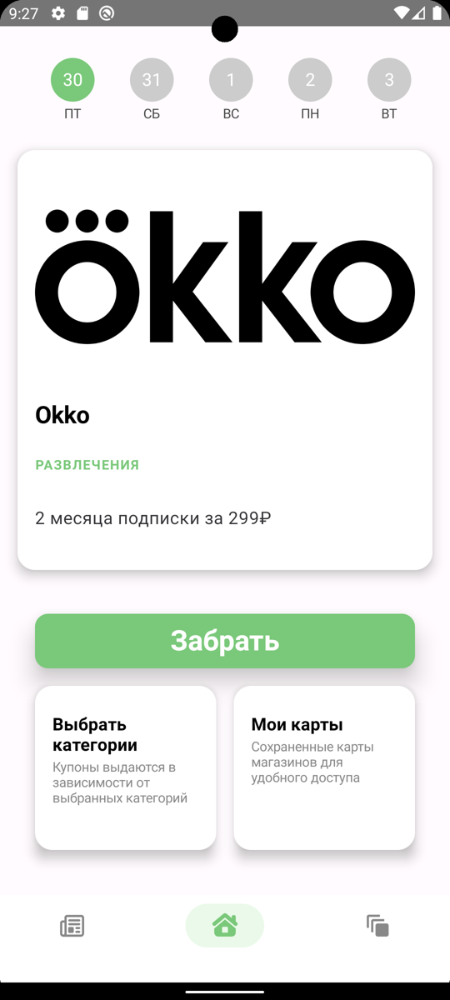
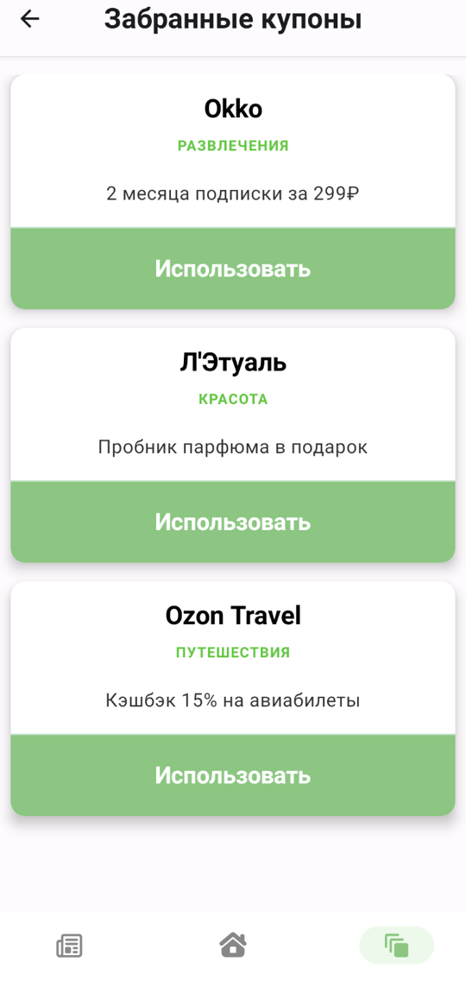
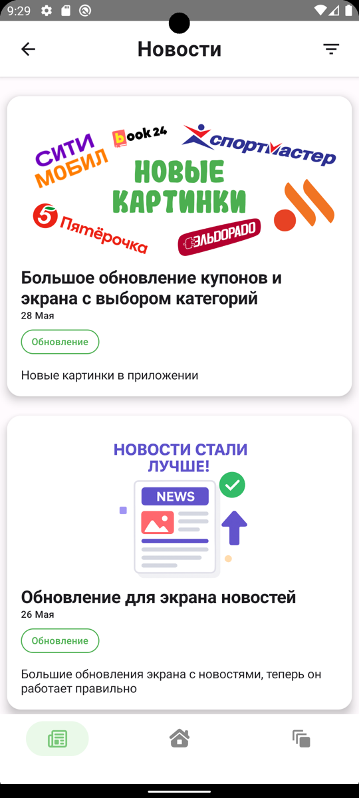
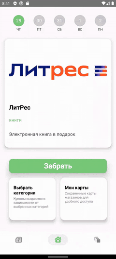
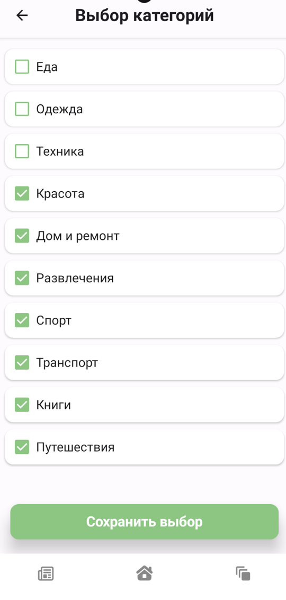
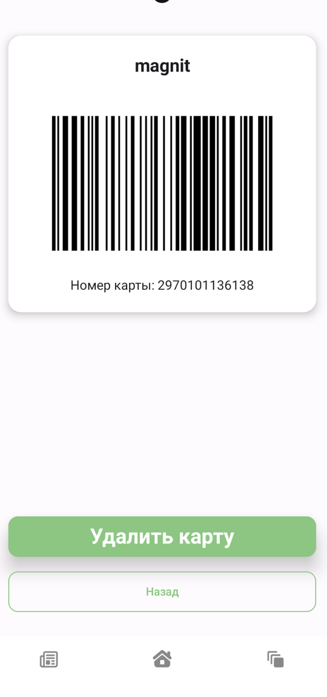

# DailyCode

**Адвент-календарь с купонами** — Android-приложение, которое каждый день дарит пользователю новый купон, скидку или бонус от магазинов-партнёров.

> 🎓 Выпускной проект курса **Samsung Innovation Campus**, трек «Мобильная разработка».

<p align="center">
  
  
  
</p>

<p align="center">
  
  <br>
  <sub>Демо в ускоренном режиме · <a href="assets/demo.mp4">полное видео (MP4)</a></sub>
</p>

## Идея

Цифровой адвент-календарь с купонами и бонусами, который мотивирует заходить в приложение каждый день, чтобы получить эксклюзивное предложение от магазина-партнёра.

## Как это работает

- Каждый день пользователь открывает «день» в календаре и получает случайный купон: скидку, бонус или подарок.
- Купоны уникальны для каждого дня и не повторяются, если пользователь уже получал их раньше.
- При повторном открытии той же даты показывается тот же купон — последовательность сохраняется.
- Магазины-партнёры размещают свои купоны в системе, чтобы продвигать новые товары и акции, своё приложение или сайт и повышать узнаваемость бренда среди молодёжной аудитории.

## Возможности

- 🎁 **Ежедневный купон** — «что будет сегодня?» с кнопкой «Забрать».
- 🗂 **Выбор категорий** — купоны подбираются под интересы: еда, одежда, техника, красота, дом и ремонт, развлечения, спорт, транспорт, книги, путешествия.
- 💳 **Дисконтные карты** — сканирование штрихкодов и QR-кодов и хранение карт магазинов в одном месте.
- 🔔 **Уведомления** — напоминание о новом купоне, чтобы его не пропустить.
- 📰 **Новости** — обновления приложения и новости партнёров.
- 🧾 **Забранные купоны** — все полученные предложения в одном списке с кнопкой «Использовать».

## Скриншоты

| Главный экран | Выбор категорий | Мои карты |
|:---:|:---:|:---:|
|  |  |  |

| Забранные купоны | Новости |
|:---:|:---:|
|  |  |

## Ценность

**Для пользователя**
- ежедневный интересный опыт;
- прямая выгода — скидки, бонусы и подарки;
- удобное хранение купонов и карт в одном месте.

**Для бизнеса**
- рост охвата и вовлечённости;
- привлечение новых клиентов;
- продвижение определённых товаров и услуг в нужные дни.

## Целевая аудитория

- **Молодёжь и студенты (14–25 лет)** — ищут выгодные предложения, часто посещают кафе, магазины и сервисы, ценят удобство, дизайн и геймификацию.
- **Экономные покупатели (25–40 лет)** — заинтересованы в реальной экономии и готовы пользоваться приложением ради выгодных купонов.
- **Партнёрские бренды и локальные бизнесы** — малые и средние магазины, кафе и сервисы, которым нужны недорогие каналы продвижения и возможность привлечь или вернуть клиентов.

## Технологии

| Задача | Технология |
|---|---|
| UI | Jetpack Compose |
| Архитектура | MVVM, Clean Architecture |
| Хранение купонов | Firebase Firestore |
| Локальные данные и настройки | DataStore |
| Сканирование штрихкодов и QR-кодов | CameraX + ML Kit |
| Уведомления | WorkManager |

## Установка и запуск

> Заполните под свой проект.

```bash
git clone https://github.com/<user>/<repo>.git
```

1. Откройте проект в Android Studio.
2. Добавьте свой `google-services.json` (Firebase) в папку `app/`.
3. Запустите на эмуляторе или устройстве с Android.

## Автор

Денисов Андрей, группа ИКБО-64-24  
Выпускной проект Samsung Innovation Campus, трек «Мобильная разработка»
